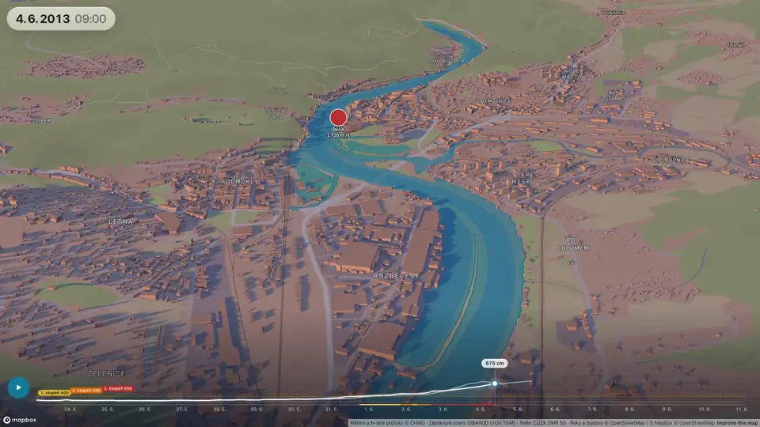
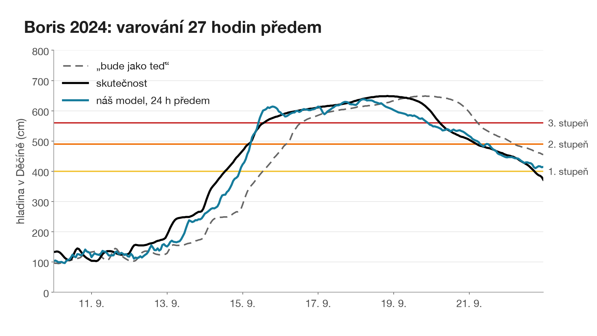
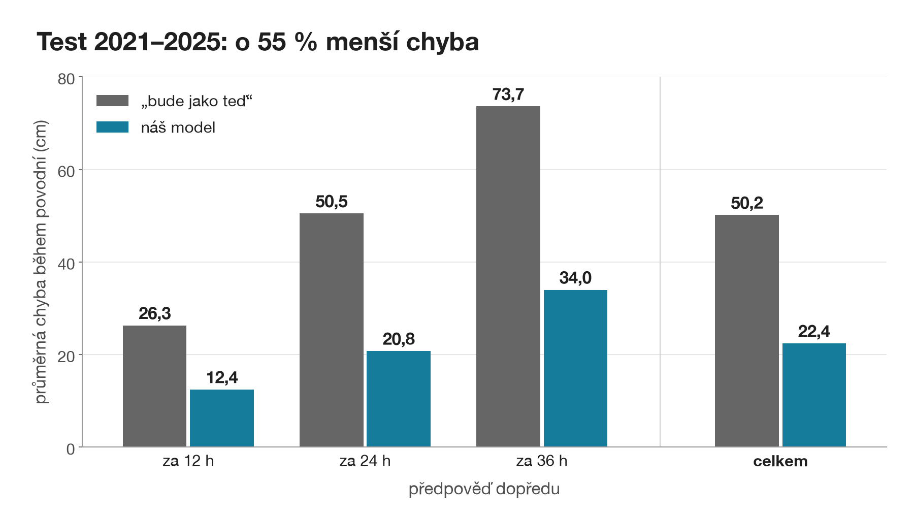
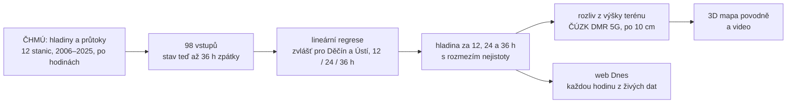
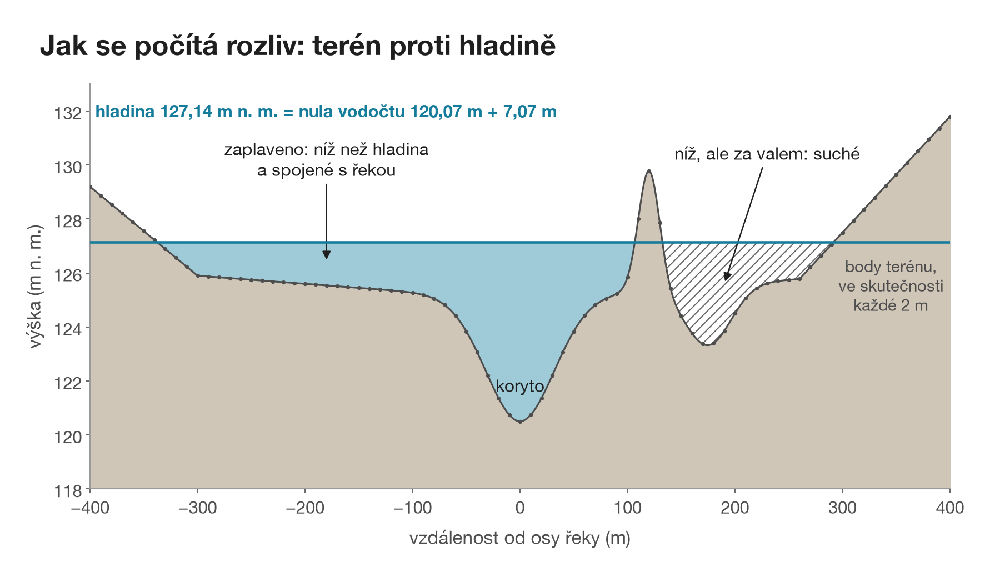
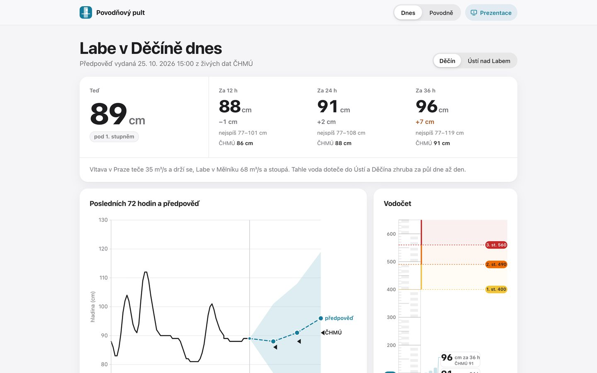
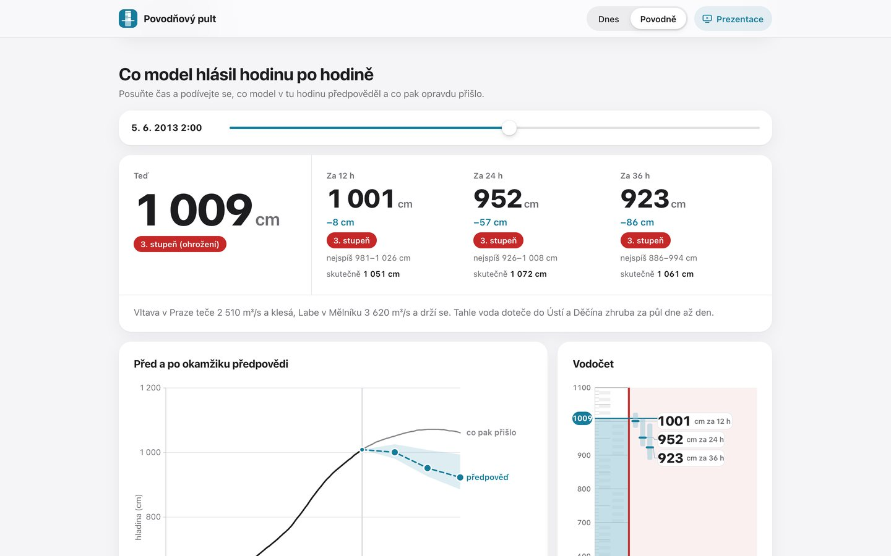

# Povodňový pult

**Den předem víme, kam v Děčíně dosáhne voda.** Předpověď hladiny Labe v Děčíně a Ústí nad Labem na 12, 24 a 36 hodin dopředu a 3D mapa, kam až se voda rozlije.

[](https://ksi.fjfi.cvut.cz/udalosti/hackathon-mlai-2026)
[](https://povodnovy-pult.netlify.app)
[](https://povodnovy-pult.netlify.app/prezentace/)
[](https://github.com/ondrej-cloud/hackathon-decin-2026-ml-ai/actions/workflows/dnesek.yml)

<p align="center">
  
</p>

S tímhle projektem jsme **vyhráli Hackathon ML/AI 2026**, který pořádala FJFI ČVUT v Děčíně 23. a 24. října 2026. Byli jsme čtyři středoškoláci a za 22 hodin jsme řešili úlohu [Dokážete předpovědět Labe?](zadani/README.md) a porotě jsme za 7 minut ukázali celý řetězec: data, čtyři porovnané modely, ověření na povodních, které model nikdy neviděl, a aplikaci, které rozumí i laik.

**[Web](https://povodnovy-pult.netlify.app)** · **[Prezentace](https://povodnovy-pult.netlify.app/prezentace/)** · **[Deník z 24 hodin](docs/DENIK.md)** · **[Cesta k modelu](docs/CESTA_MODELU.md)**

## Výsledek

| | Náš model | „Bude jako teď“ |
|---|---|---|
| Test 2021–2025, průměrná chyba během povodní | **22,4 cm** | 50,2 cm |
| Vícenásobná validace, 8 povodní 2006–2013 | **20,1 cm** | 45,2 cm |
| Povodeň Boris 9/2024, varování před 3. stupněm v Děčíně | **27 h předem** | nevaruje |
| Povodeň 6/2013, největší v datech, model ji při učení neviděl | **3. stupeň 18 h předem**, vrchol 952 cm proti skutečným 1 072 cm | nevaruje |

„Bude jako teď“ je laťka, se kterou se srovnáváme: hladina za 24 hodin bude stejná jako teď. Na všech povodních má náš model zhruba poloviční chybu. Testovací roky 2021–2025 jsme pustili jen jednou, na model vybraný předem, takže čísla nejsou vyladěná na test.

<p align="center">
  
  
</p>

## Jak to funguje

Voda, která dnes teče v Praze, Mělníku nebo Lounech, bude zítra v Děčíně. Labe v Děčíně je součet Vltavy, horního Labe a Ohře, a z každé větve víme, kolik vody už je na cestě a za jak dlouho doteče.



- **Data.** Balíček od pořadatelů měl nejvýš proti proudu Ústí, jen 4 hodiny před Děčínem, a jedinou povodeň. Doplnili jsme proto otevřená data ČHMÚ: 20 let, 12 stanic na Labi, Vltavě, Ohři a přítocích, 175 320 hodin. Podrobně v [docs/DATA.md](docs/DATA.md) a [docs/ZDROJE_DAT.md](docs/ZDROJE_DAT.md).
- **Vstupy.** Hladina v Děčíně a Ústí a průtoky všech 12 stanic teď a až 36 hodin zpátky, 98 čísel. Jen to, co je v okamžiku předpovědi už změřené. Srážky, sníh ani teplota na validaci nepomohly.
- **Čtyři modely, vyhrál nejjednodušší.** Každý z nás zkusil jiný princip na stejných datech a se stejným vyhodnocením. Lineární regrese vyšla nejlíp a dá se celá vysvětlit, proto je finální.

  | Model (validace) | Chyba během povodní |
  |---|---|
  | **lineární regrese** | **17,1 cm** |
  | neuronová síť (MLP) | 17,8 cm |
  | LightGBM | 23,1 cm |
  | fyzikální model (doba putování a měrná křivka) | 24,8 cm |
  | „bude jako teď“ | 44,3 cm |

- **Ověření.** Dělení vždy v čase, nikdy náhodně. Validace na celých povodních vynechaných z učení, vícenásobná validace přes 8 povodní a jeden finální test 2021–2025. Postup a všechna rozhodnutí v [docs/PREHLED.md](docs/PREHLED.md), každý pokus včetně nepovedených v [docs/POKUSY.md](docs/POKUSY.md).
- **Rozliv.** Z předpovězené hladiny spočítáme, kam voda dosáhne: zaplavené je všechno pod hladinou, co je spojené s korytem. Terén je z ČÚZK DMR 5G (2 m), shoda s oficiálními záplavovými územími DIBAVOD je IoU 0,82–0,90.

<p align="center">
  
</p>

## Web

Na [povodnovy-pult.netlify.app](https://povodnovy-pult.netlify.app) jsou dvě stránky. **Dnes** ukazuje hladinu teď a předpověď na 12, 24 a 36 hodin s rozmezím nejistoty a vedle ní oficiální předpověď ČHMÚ. GitHub Action ji každou hodinu přepočítá z živých dat. **Povodně** přehraje šest historických povodní: 3D mapu rozlivu, jak přesná byla předpověď a co model hlásil hodinu po hodině.

<p align="center">
  
  
</p>

Web je statický, bez serveru: předpočítaná data v JSON, grafy ve vlastním SVG, mapa v Mapbox GL. Jak se staví a nasazuje, je v [docs/WEB.md](docs/WEB.md).

## Spuštění

```bash
python3 -m venv .venv && source .venv/bin/activate
pip install -r app/requirements.txt

python src/porovnej.py ridge          # natrénuje a vyhodnotí model na validaci
python src/porovnej.py --prehled      # srovnání všech modelů
streamlit run app/app.py              # aplikace na http://localhost:8501

python src/uloz_model.py && python src/uloz_model.py --vse
python src/export_web.py --vse        # data, mapy a animace pro web
python src/dnesek_export.py           # předpověď na dnešek z živých dat ČHMÚ
npx serve web                         # web na http://localhost:3000
```

Hodinová data jsou v repu (`data/external/labe_hodinove.parquet`), nic se nestahuje. Mapy a animace potřebují `MAPBOX_TOKEN` v souboru `.env`, bez něj aplikace použije OpenStreetMap.

## Co je kde

| Složka | Co tam je |
|---|---|
| [`src/`](src) | data, společné vstupy (`features.py`) a vyhodnocení (`evaluate.py`), modely v `src/models/`, export webu, video |
| [`app/`](app) | aplikace ve Streamlitu, 3D mapa v Mapbox GL, rozliv z terénu, živá data ČHMÚ |
| [`web/`](web) | statický web a HTML prezentace (`web/prezentace/`) |
| [`data/external/`](data/external) | hodinové hladiny a průtoky ČHMÚ 2006–2025, stanice, rozlivy |
| [`results/`](results) | výsledek každého pokusu jako samostatný soubor |
| [`docs/`](docs) | deník, pokusy, data, cesta k modelu, porozumění úloze, grafy |
| [`prezentace/`](prezentace) | texty řečníků, otázky poroty, grafy do slajdů |
| [`zadani/`](zadani) | zadání úlohy |

## Tým

| | Na čem dělal |
|---|---|
| **Ondra** ([ondrej-cloud](https://github.com/ondrej-cloud)) | vedení týmu a ověřování výsledků, finální test, neuronová síť |
| **Dan** ([midaxal](https://github.com/midaxal)) | LightGBM, rozmezí nejistoty předpovědi, grafy do prezentace |
| **Honza** ([jo413](https://github.com/jo413)) | lineární regrese (finální model), aplikace a web, 3D mapa a rozliv z terénu |
| **Tobias** ([tobiaszlobias](https://github.com/tobiaszlobias)) | fyzikální model, prezentace, úvodní video |

## Data a poděkování

Měření hladin a průtoků a N-leté průtoky: [ČHMÚ](https://www.chmi.cz) (otevřená data). Terén: ČÚZK DMR 5G. Záplavová území: DIBAVOD (VÚV TGM). Řeky a budovy: © přispěvatelé OpenStreetMap. Mapa: Mapbox. Předpověď srážek na stránce Dnes: Open-Meteo. Díky pořadatelům z FJFI ČVUT a mentorům za zadání a rady během noci.

## Limity

Model vidí jen řeku, ne déšť, proto předpovídá nejvýš 36 hodin dopředu: dál už rozhoduje počasí, které ještě nespadlo. Rozliv je statický, bez proudění a hrází menších než rozlišení terénu. Je to výsledek 22 hodin práce, ne náhrada oficiální předpovědi ČHMÚ.

---

**In English.** Winning project of Hackathon ML/AI 2026 (Faculty of Nuclear Sciences and Physical Engineering, Czech Technical University, held in Děčín). We forecast the water level of the Elbe in Děčín and Ústí nad Labem 12, 24 and 36 hours ahead from 98 upstream gauge readings (20 years of hourly open data from the Czech Hydrometeorological Institute). A ridge regression beat a neural net, LightGBM and a physics-based routing model and halves the error of the persistence baseline on the untouched 2021–2025 test set (22.4 vs 50.2 cm during floods). It warned 27 h ahead of the flood stage 3 during storm Boris (2024). The forecast drives a terrain-based 3D flood map and a live website updated every hour.
